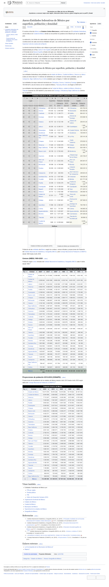

# Práctica 1 – Conectar servidores MCP a un agente

## 1. Descripción

Práctica de Ingeniería en Sistemas Computacionales sobre el **Model Context Protocol (MCP)**: se conectan dos servidores MCP locales (`filesystem` y `playwright`) a un agente de programación y se resuelven tareas que combinan ambos, comprobando además los límites de acceso del servidor. Se añade un tercer servidor (`memory`) como Actividad D.

- **Agente:** Claude Code (app de escritorio; CLI `claude` 2.1.84), modelo `claude-sonnet-5-5`. Ruta A de la guía.
- **Sistema:** Windows 11, Node.js v24.20.0, npm/npx 11.19.0, Git 2.51.0.
- **Servidores (versión publicada en npm al 10-nov-2026):** `@modelcontextprotocol/server-filesystem` 2.2.0, `@playwright/mcp` 0.0.85, `@modelcontextprotocol/server-memory` 2.1.0.
- **Navegador:** Chrome en modo `--headless` (sin ventana).

## 2. Requisitos y reproducción

Requisitos: Node.js 18+ (con `npx`), Google Chrome, Git, Claude Code y conexión a internet.

Para repetir la práctica desde cero:

1. Clona el repositorio y entra a la carpeta (`git clone https://github.com/Koraah0408/practica1-mcp.git`).
2. **Cambia la ruta** en `.mcp.json`: en el servidor `filesystem`, el último argumento es la ruta absoluta de la carpeta (en Windows con barras dobles: `C:\\Users\\TU_USUARIO\\practica1-mcp`). Esa es la única carpeta a la que tendrá acceso. También puedes regenerar el archivo con:
   ```powershell
   claude mcp add --scope project filesystem -- cmd /c npx -y "@modelcontextprotocol/server-filesystem" "$PWD"
   claude mcp add --scope project playwright -- cmd /c npx -y "@playwright/mcp@latest" --headless
   claude mcp add --scope project memory -- cmd /c npx -y "@modelcontextprotocol/server-memory"
   ```
3. Abre `claude` en la carpeta, aprueba los servidores del proyecto y comprueba con `/mcp` (o `claude mcp list`) que los tres aparecen conectados.
4. Pega en el chat el texto de cada archivo de `instrucciones/` y aprueba las llamadas. El texto de `actividad_d.txt` es el que usé como guion.

> Nota: la ruta de `.mcp.json` y de algunos registros de `evidencias/` muestra mi usuario de Windows, tal como indica la guía. En una instalación nueva se sustituye por la ruta propia.

## 3. Servidores MCP

| Servidor | Paquete | Cómo se configuró | Herramientas |
|---|---|---|---|
| `filesystem` | `@modelcontextprotocol/server-filesystem` | `claude mcp add --scope project`, con la carpeta de la práctica como único directorio permitido | `read_file`, `read_text_file`, `read_media_file`, `read_multiple_files`, `write_file`, `edit_file`, `create_directory`, `list_directory`, `list_directory_with_sizes`, `directory_tree`, `move_file`, `search_files`, `get_file_info`, `list_allowed_directories` |
| `playwright` | `@playwright/mcp` | igual, con el argumento `--headless` | `browser_navigate`, `browser_navigate_back`, `browser_snapshot`, `browser_evaluate`, `browser_run_code_unsafe`, `browser_click`, `browser_type`, `browser_fill_form`, `browser_press_key`, `browser_hover`, `browser_drag`, `browser_drop`, `browser_select_option`, `browser_file_upload`, `browser_handle_dialog`, `browser_wait_for`, `browser_tabs`, `browser_resize`, `browser_find`, `browser_take_screenshot`, `browser_console_messages`, `browser_network_requests`, `browser_network_request`, `browser_emulate_media`, `browser_close` |
| `memory` (Act. D) | `@modelcontextprotocol/server-memory` | igual, sin argumentos | `create_entities`, `create_relations`, `add_observations`, `delete_entities`, `delete_observations`, `delete_relations`, `read_graph`, `search_nodes`, `open_nodes` |

`claude mcp list` mostró los tres servidores como **Connected**. Esos nombres son los que la sesión de Claude Code listó para cada servidor (en Claude Code se invocan como `mcp__servidor__herramienta`).

El archivo de configuración es [`.mcp.json`](.mcp.json).

## 4. Actividades A, B y C

Las instrucciones se dieron tal como vienen en la guía y están en [`instrucciones/`](instrucciones/). Las herramientas son las del servidor MCP indicado.

### Actividad A – Lectura y escritura de archivos (`filesystem`)

- **Instrucción:** [`actividad_a.txt`](instrucciones/actividad_a.txt)
- **Secuencia de herramientas:**
  1. `list_directory` → `[FILE] calificaciones.csv`
  2. `read_text_file` sobre `datos/calificaciones.csv` → contenido del CSV
  3. `write_file` sobre `salida/reporte.md` → `Successfully wrote to ...`
- **Resultado:** [`salida/reporte.md`](salida/reporte.md) con los 8 alumnos ordenados por promedio. Aprueban 6; no aprueban Diego Ruiz (5.50) y Hector Vega (5.33). Promedio del grupo: **7.50**, igual que lo esperado. El cálculo lo hace el modelo; el servidor solo lee y escribe. Hay un empate en 9.50 (Carla Mendez y Gabriela Luna), resuelto por orden de matrícula.

### Actividad B – De una página web a un CSV (`playwright` + `filesystem`)

- **Instrucción:** [`actividad_b.txt`](instrucciones/actividad_b.txt)
- **Secuencia de herramientas:**
  1. `playwright › browser_navigate` a `https://es.wikipedia.org/?curid=5897912`
  2. `playwright › browser_evaluate` para listar las tablas de la página y elegir la correcta (índice 0; las otras dos son de población histórica)
  3. `playwright › browser_evaluate` para leer las primeras filas e identificar las columnas (nombre, superficie, población 2020, densidad)
  4. `playwright › browser_evaluate` para extraer las 32 filas ya limpias y en formato CSV
  5. `filesystem › write_file` sobre `salida/entidades.csv`
  6. `playwright › browser_take_screenshot` (página completa)
  7. `playwright › browser_evaluate` para comprobar tres filas contra el DOM
  8. `playwright › browser_close`
- **Cambio de servidor:** en el paso 5. Hasta el paso 4 todo es `playwright` (obtener los datos); `filesystem` entra solo para escribir el CSV, porque playwright no escribe en el disco del proyecto.
- **Cómo se obtuvieron los datos:** **ejecutando JavaScript** (`browser_evaluate`) sobre la tabla del DOM, no leyendo el texto de la página. El script quita espacios de miles y notas `[1]` y pasa la coma decimal a punto.
- **Resultado:** [`salida/entidades.csv`](salida/entidades.csv) con encabezado y **32 filas**; la primera es Chihuahua con 247455 km², como se esperaba. La población corresponde a la **estimación de 2020** y la columna de densidad está rotulada **2015**.
- **Verificación de tres filas** ([registro](evidencias/b_verificacion_filas.txt)): Jalisco (80295 / 8348151 / 100), Yucatán (39524 / 2320898 / 53) y Ciudad de México (1495 / 9209944 / 5966) coinciden con la tabla.



### Actividad C – Los límites del servidor (`filesystem`)

- **Instrucción:** [`actividad_c.txt`](instrucciones/actividad_c.txt)
- **Secuencia de herramientas:** `list_allowed_directories` → `read_text_file` (`C:/Windows/win.ini`) → `list_directory` (carpeta padre, el Escritorio).
- **Respuestas textuales** ([registro](evidencias/c_registro_limites.txt)):
  1. `Allowed directories: C:\Users\marqu\OneDrive\Desktop\practica1-mcp`
  2. `Access denied - path outside allowed directories: C:\Windows\win.ini not in C:\Users\marqu\OneDrive\Desktop\practica1-mcp`
  3. `Access denied - path outside allowed directories: C:\Users\marqu\OneDrive\Desktop not in C:\Users\marqu\OneDrive\Desktop\practica1-mcp`
- **¿Quién impuso el límite?** El **servidor**. El modelo sí pidió las dos lecturas y el host las dejó pasar; fue el proceso `filesystem` el que las rechazó con su propia lista de directorios permitidos (los que recibió como argumento al arrancar). Que lo imponga el servidor es más fiable que escribirlo en el prompt, porque una instrucción en texto puede ignorarse o ser sobrescrita por contenido externo, mientras que el servidor aplica la regla siempre.

## 5. Actividad D – Un tercer servidor

- **Servidor:** `@modelcontextprotocol/server-memory` (memoria persistente como grafo de conocimiento).
- **Quién lo publica:** el equipo mantenedor del protocolo MCP, en el repositorio oficial [modelcontextprotocol/servers](https://github.com/modelcontextprotocol/servers).
- **Herramientas:** `create_entities`, `create_relations`, `add_observations`, `delete_entities`, `delete_observations`, `delete_relations`, `read_graph`, `search_nodes`, `open_nodes`.
- **Tarea:** modelar la propia práctica como grafo: tres entidades (`Practica 1 MCP`, `filesystem`, `playwright`), dos relaciones `usa`, una observación sobre el límite de `filesystem`, y luego consulta con `read_graph` y `search_nodes` (query `servidor`). Guion en [`actividad_d.txt`](instrucciones/actividad_d.txt).
- **Cómo se ejecutó:** el servidor se agregó con `claude mcp add` ya iniciada la sesión, y Claude Code no cargó sus herramientas hasta reiniciar. En lugar de reiniciar, ejecuté las mismas llamadas con un cliente MCP mínimo ([`cliente_mcp_actividad_d.mjs`](evidencias/cliente_mcp_actividad_d.mjs)) que lanza el servidor por stdio y habla JSON-RPC (`initialize`, `tools/list`, `tools/call`). Es el mismo protocolo que usa el cliente integrado del host. Registro completo en [`evidencias/d_registro_memory.txt`](evidencias/d_registro_memory.txt). El grafo se guardó en un archivo fuera del repositorio.
- **Por qué lo considero confiable:** lo mantienen los autores del protocolo, el código es público, no pide claves ni tokens, no hace peticiones de red (solo lee y escribe un archivo local de grafo) y no accede a otras carpetas del equipo.

## 6. Problemas encontrados

- **La CLI `claude` en terminal devolvió 401** (`OAuth access token has expired`) al intentar el modo no interactivo del apéndice de la guía. Lo resolví usando las herramientas MCP directamente en la sesión de Claude Code, que ya tenía los servidores conectados.
- **Las herramientas de `memory` no aparecieron** porque el servidor se registró después de abrir la sesión; se resolvió con el cliente JSON-RPC descrito arriba.
- **Tabla equivocada en Wikipedia:** la página tiene tres tablas parecidas (las otras dos son de población histórica). Se listaron todas y se eligió la de índice 0. Además, la fila de encabezado está dividida en tres filas, por eso se tomaron las filas de datos desde la cuarta.
- **Verificación:** 32 filas, primera fila = Chihuahua, tres filas contrastadas con el DOM; el promedio del grupo (7.50) y las dos reprobaciones coinciden con lo esperado.
- **Avisos `LF will be replaced by CRLF` de Git** en Windows: son inofensivos.
- **Pendiente:** las capturas de pantalla de la interfaz (`/mcp` con los servidores conectados y las ventanas de aprobación) no se pudieron tomar desde el agente; el estado de los servidores está documentado con la salida de `claude mcp list` en el apartado 3.

## 7. Fuentes

- Wikipedia, «[Anexo:Entidades federativas de México por superficie, población y densidad](https://es.wikipedia.org/?curid=5897912)» (datos de `salida/entidades.csv`).
- Documentación del protocolo: <https://modelcontextprotocol.io>
- MCP en Claude Code: <https://code.claude.com/docs/en/mcp>
- Servidores de referencia (`filesystem`, `memory`): <https://github.com/modelcontextprotocol/servers>
- Servidor playwright: <https://github.com/microsoft/playwright-mcp>
- Guía de la práctica: `practica1_mcp.pdf` (del curso).
